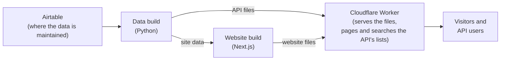

# Mutual Aid NYC Resource Directory

Powers the Mutual Aid NYC Community Resources Library. A build pulls the directory's data from an [Airtable](https://airtable.com) base and turns it into a static website and a read-only [HSDS](https://docs.openreferral.org/) API.

It follows the core Human Services Data Specification (HSDS) from the [Open Referral Initiative](https://openreferral.org/), and the build checks every record against HSDS's JSON Schemas.

Note: The code and API use HSDS's terms "service" and "organization", while the site uses "resource" and "group" to better align with the domain of mutual aid.

## How it works

Data is edited in Airtable, turned into files by two builds, and served by a Cloudflare Worker as the website and the API.



1. **Airtable** is where the data is maintained.
2. **The data build** (`build_dataset.py`, Python) pulls specified tables/fields from Airtable, keeps only published services and what they link to, and checks each record against HSDS. It writes the API's records as JSON files, plus the data the site and the Worker need.
3. **The website** (`frontend/`, Next.js) is built from that data into plain HTML, CSS and JavaScript. It has no server and doesn't call the API.
4. **The Worker** (`worker/`, Cloudflare) serves the website and the API at `/api`. Single records are static files. The lists (`/api/services` and others) run a little code, because they need paging and search.

To change what's live: edit in Airtable. Changing a service's `status` rebuilds the site; other edits go live with the daily rebuild (see [Deployment](#deployment)). To run everything locally, see [Quick Start](#quick-start-local-development).

## Prerequisites

- Node.js 22+ (`.nvmrc`)
- To build the data from Airtable:
  - Python 3.14+
  - An Airtable base with the tables described in [Airtable base](#airtable-base)
  - An Airtable personal access token with only the `data.records:read` scope. Don't use a token with write access.

To work on the site or the Worker only, you don't need Python or a token: download production's data instead ([step 4](#4-get-the-data)).

## Quick Start (Local Development)

### 1. Clone the repository

```bash
git clone https://github.com/MutualAidNYC/resource-directory.git
cd resource-directory
```

### 2. Set up Python

Skip steps 2 and 3 if you'll download production's data in step 4.

```bash
# Create and activate virtual environment (Python 3.14+)
python3.14 -m venv venv
source venv/bin/activate  # Windows: venv\Scripts\activate

# Install dependencies
pip install -r requirements.txt -r requirements-dev.txt
```

Versions are pinned. To add or upgrade a package, edit `requirements.in` or `requirements-dev.in`, then run `pip-compile requirements.in && pip-compile requirements-dev.in` and commit the `.in` and `.txt` files.

### 3. Add your Airtable settings

```bash
cp .env.example .env
```

Set these in `.env` (create a token at https://airtable.com/create/tokens):

```env
AIRTABLE_API_KEY=pat...your_personal_access_token
AIRTABLE_BASE_ID=app...your_base_id
```

The base id is the `app…` part of the base's URL: `https://airtable.com/appXXXXXXXXX/…`.

### 4. Get the data

With an Airtable token (steps 2–3), build it:

```bash
python build_dataset.py   # repo root: pulls Airtable, writes dist/
```

Without a token, download what production last built. It won't show changes to the data build or newer Airtable edits:

```bash
PRODUCTION_URL=https://… bash worker/scripts/fetch-data.sh   # writes dist/
```

### 5. Run the site and the API

```bash
cd frontend
npm install
npm run build             # writes frontend/out/
cd ../worker
npm install
npm run dev               # http://localhost:8787: the site, and the API at /api
```

`npm run dev` writes `dist/public/` and serves it the way Cloudflare does. It needs no Cloudflare account.

### 6. Optional: work on the site with live reload

```bash
cd frontend
npm run dev               # http://localhost:3000; reloads as you edit; no API
```

To pick up new data from Airtable, rerun step 4.

## Testing and CI

Run the checks for the parts you changed:

| Where | Checks |
|-------|--------|
| Repo root (venv active) | `pytest tests/unit`, `ruff check .`, `pyright` |
| `frontend/` | `npm run lint`, `npm run typecheck` |
| `worker/` | `npm test`, `npm run typecheck` |

The unit tests need no Airtable access and include the HSDS schema check. `pytest tests/unit --cov` fails below 94% coverage.

GitHub Actions runs these checks on every pull request and on pushes to `main` (`.github/workflows/checks.yml`).

Dependabot opens update PRs every two months: one each for pip, npm and GitHub Actions, with minor and patch updates only. Each pip or npm major update gets its own PR (`.github/dependabot.yml`).

## Static build

`python build_dataset.py` writes:

- `dist/api/`: the API's static files (one per record, the full download, the OpenAPI description).
- `dist/site-data/map.json`: the site's own data read when the site builds: map pins, category names, search fields, filter values.
- `dist/worker-data/data.json`: the lists, filters and search fields the API's code serves. Built into that code.

The deploy also publishes all three as `/build-data.tar.gz`, for [previews](#previews).

It then prints a build report of what to fix in Airtable. The build fails only if the pull fails or finds no published services. The HSDS version is `HSDS_VERSION` in `models/hsds.py`. Its schemas, and how to upgrade, are in [`schemas/hsds/`](schemas/hsds/README.md).

## Airtable base

The build requests only the tables and fields listed in `airtable.toml`, so private/internal fields never leave Airtable. Field names must match Airtable exactly. A table's optional `filter` limits which records are pulled. Tables and fields left out are treated as empty. 

To add a new field, also add it to its models in `models/airtable.py` and `models/hsds.py`, and set it in `application_layer/`.

The base needs:

- **Publishing.** The `services` filter in `airtable.toml` decides which services are published (Mutual Aid NYC's: `{status} = 'Published'`). Without a filter, every service is published. An organization is shown only if it has a published service. The `organizations` filter can exclude more (Mutual Aid NYC's excludes "Do Not Publish").
- **Categories.** Services' category fields are matched by name to `taxonomy_terms` in two taxonomies. The fields (`needFocus`, `communityFocus`) are read in `models/airtable.py`, and the taxonomy names ("MANYC Need", "MANYC Community Focus") are set in `application_layer/taxonomies.py`.
- **Locations.** Services link to locations only through `service_at_location`. Coordinates are on `locations` (`latitude`, `longitude`). This app doesn't geocode: add coordinates in Airtable.
- **Service areas** are the areas a service is for, not its location (specified in the `service_areas` field).
- **Ids.** Public ids (UUIDs) are made from Airtable record ids, so no id field is needed. Moving records to another base or table changes their ids.

### Connecting your own base

1. Copy `airtable.toml`. For each table, set `id` to its Airtable table id (`tbl…`, under **Help → API documentation**), or leave `id` out if the Airtable table has the same name as the section (for example `services`). List the fields to read and set the filters. If your category fields or taxonomies have other names, see **Categories** above.
2. In `.env`, set `AIRTABLE_BASE_ID`, and `AIRTABLE_CONFIG` to your copy's path.
3. Run `python build_dataset.py` and fix what the build report lists.

## API

A read-only [HSDS](https://docs.openreferral.org/en/latest/hsds/api_reference.html) API at `/api`.

| Endpoint | Served as | Returns |
|----------|-----------|---------|
| `/api` | code | API info: HSDS version, publisher, `openapi_url` |
| `/api/services`, `/api/organizations`, `/api/service_at_locations`, `/api/taxonomies`, `/api/taxonomy_terms` | code | An HSDS list, paginated |
| `/api/<list>/{id}` | static file | One record, fully nested |
| `/api/download.json` | static file | Every published record |
| `/api/openapi.json` | static file | The OpenAPI description |

`/api/organizations/{id}` includes the organization's locations and phones but not its services. For those, use `/api/services?organization_id={id}`.

### List parameters

| Parameter | Lists | Notes |
|-----------|-------|-------|
| `page`, `per_page` | all | 50 per page by default; at most 1,000 |
| `search` | all | Search returns the records that contain every word you search for |
| `organization_id` | services, service_at_locations | |
| `taxonomy_term_id`, `taxonomy_id` | services, organizations, service_at_locations | For organizations: those with a matching service |
| `taxonomy_id`, `parent_id`, `top_only` | taxonomy_terms | |

Errors return JSON: `{"error": "…"}`. A request gets a 400 if it uses an HSDS parameter this API doesn't support (`modified_after`, `minimal`, `full`, `full_service`, `postcode`, `proximity`, or `format` other than `json`), has a bad value, or repeats a parameter. To get everything, use `/api/download.json`. Parameters HSDS doesn't define are ignored. Only GET and HEAD are allowed.

## Configuration

### Files

| File | Read by | Committed |
|------|---------|-----------|
| `.env` (repo root) | `build_dataset.py` | No: it holds your Airtable token |
| `airtable.toml` | `build_dataset.py` | Yes |
| `frontend/.env.local` | `npm run dev` and `npm run build` in `frontend/`. Optional. | No |
| `worker/wrangler.jsonc` | wrangler: `npm run dev` in `worker/`, and deploys | Yes |

### Build settings (`.env`)

| Variable | Default | Description |
|----------|---------|-------------|
| `AIRTABLE_API_KEY` | *(required)* | Airtable personal access token (read-only) |
| `AIRTABLE_BASE_ID` | *(required)* | Airtable base id (`appXXXXXXXXX`) |
| `AIRTABLE_CONFIG` | `airtable.toml` | The tables and fields to read (see [Airtable base](#airtable-base)) |

### Frontend settings

| Variable | Default | Description |
|----------|---------|-------------|
| `SITE_DATA_DIR` | `../dist` | The build's output folder, relative to `frontend/` |
| `NEXT_PUBLIC_BASEMAP_STYLE_URL` | OpenFreeMap bright | The map's basemap style URL |

`NEXT_PUBLIC_` variables are public. Put secrets only in the root `.env`.

## Deployment

The site and the API deploy together to Cloudflare as one Worker, `resource-directory`. [Workers Builds](https://developers.cloudflare.com/workers/ci-cd/builds/) builds and deploys it when:

- There is a commit to the `main` branch.
- A service's `status` changes in Airtable: an automation runs `worker/scripts/airtable-rebuild.js`.
- Once a day, with the Worker's Cron Trigger (`worker/src/rebuild.ts`).

The last two POST the Worker's deploy hook.

### Workers Builds settings

| Setting | Value |
|---------|-------|
| Branch | `main`; Enable Preview Builds off (other branches must not build with the Airtable token) |
| Root directory | `worker` |
| Build command | `cd .. && bash worker/scripts/build.sh` |
| Deploy command | `npx wrangler deploy` |
| Build variables | `AIRTABLE_BASE_ID`, `NODE_VERSION` = `22`, `PYTHON_VERSION` = `3.14.8` (the build image's own Python, so builds don't install one) |
| Build secret | `AIRTABLE_API_KEY` (a build variable set to encrypted) |
| Deploy hook | One, on `main`. Its URL is a secret |
| Runtime secret | `DEPLOY_HOOK_URL`: the hook's URL, for the daily rebuild. |

### Previews

A second Worker, `resource-directory-preview`, gives every branch a Preview URL ([Worker Previews](https://developers.cloudflare.com/workers/previews/)), and Cloudflare comments it on the branch's PR. It has no Airtable token, so it builds from production's data: previews show changes to the site and the Worker, not to `build_dataset.py`. Builds of `main` deploy a copy of production to it.

Its settings differ from production's in:

| Setting | Value |
|---------|-------|
| Branch | `main`; Enable Preview Builds on |
| Build command | `cd .. && bash worker/scripts/build.sh preview` |
| Deploy command | `npx wrangler deploy --env preview` |
| Preview command | `npx wrangler preview --env preview` |
| Build variables | `PRODUCTION_URL`, `NODE_VERSION` = `22`, set on both the **Production** and **Previews Base** tabs (preview builds use only Previews Base). No Airtable token |
| Deploy hook, runtime secret | None |

### Deploying manually

Needs a Cloudflare account with access to the Worker. From the repo root:

```bash
python build_dataset.py                    # pull Airtable, write dist/
(cd frontend && npm ci && npm run build)   # build the site
cd worker
npm ci
npx wrangler login                         # once per machine
npm run assemble                           # write dist/public/
npx wrangler deploy
```

The next build from Workers Builds replaces a manual deploy.

## Before launch

Until the site launches, it asks search engines not to index it. To launch, remove that from all three places:

- `frontend/src/app/layout.tsx`: `robots: { index: false }`
- `worker/_headers`: the `X-Robots-Tag: noindex` rule
- `worker/src/handler.ts`: `NOINDEX`, and the `x-robots-tag` check in `worker/test/handler.test.ts`

## Troubleshooting

### The build fails

The build prints the reason:

- **`missing or invalid settings: …`**: set the named variables in `.env` (see [step 3](#3-add-your-airtable-settings)).
- **`Airtable config not found: …`**: `AIRTABLE_CONFIG` points to a file that doesn't exist.
- **`Airtable request failed (401, 403 or 404 …)`**: check that the token is valid, has the `data.records:read` scope and access to the base in `AIRTABLE_BASE_ID`, and that the table ids in `airtable.toml` belong to that base (see [Connecting your own base](#connecting-your-own-base)).
- **`no published services in the pull`**: the `services` filter in `airtable.toml` matches no records. Check it against the status values in Airtable.

### The site build fails with "Site data not found"

The site reads `dist/api/download.json` and `dist/site-data/map.json`. From the repo root, run `python build_dataset.py`, or download production's data with `worker/scripts/fetch-data.sh` (see [step 4](#4-get-the-data)).

### Map pins are missing

A service gets a pin from its first location with coordinates, found through `service_at_location`. There is no fallback.

- **The location has no coordinates.** Add `latitude` and `longitude` to the location in Airtable. The build report lists locations with an address but no coordinates.
- **The service has no location.** Link it to a location through `service_at_location`.

## Contributing

We welcome contributions! See [CONTRIBUTING.md](CONTRIBUTING.md) for guidelines.

## Credits

Adapted from code developed by [Sarapis](https://sarapis.org/), this repo is maintained by [Mutual Aid NYC](https://mutualaid.nyc) volunteers. Sarapis also maintains an implementation at [sarapis/hsd](https://github.com/sarapis/hsd).

## License

[MIT](LICENSE), except the vendored HSDS schemas in `schemas/hsds/` and `static_build/openapi.json` (adapted from HSDS's OpenAPI description): © Open Referral, [CC BY-SA 4.0](https://creativecommons.org/licenses/by-sa/4.0/).
